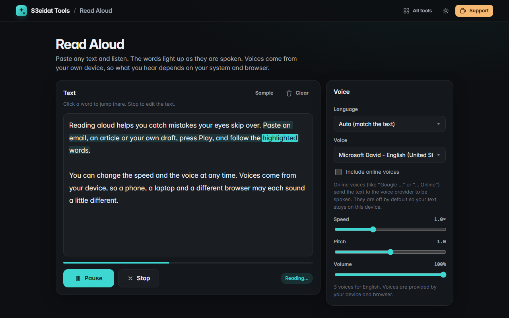

# Read Aloud

> Text to speech with the voices on your device. Free, private, and it runs in your browser.

### ▶ [Open Read Aloud](https://s3eidat.github.io/read-aloud/)



## Features

- Uses the browser's built-in **speech synthesis** with the **voices installed on your device**
- **Language filter** (or Auto, which picks Arabic voices for Arabic text) and **voice picker**
- **Speed**, **pitch** and **volume** controls; changing them mid-read continues from the current word
- **Play / Pause / Stop**, start from the cursor, or click any word while reading to jump there
- **Word and sentence highlighting** as the text is spoken (where the voice reports word boundaries)
- Long texts are split at sentence ends so browsers don't cut off after a few seconds
- Remembers your voice and settings on this device

Voices come from your operating system and browser, so the choice (and the quality) differs between devices.
Arabic works when your device has an Arabic voice installed.

## Privacy

By default only **offline voices** are listed, so your text is spoken on your device and goes nowhere.
Some browsers also offer **online voices** (for example “Google …” in Chrome or “… Online (Natural)” in Edge);
those send the text to the voice provider. They only appear if you tick **Include online voices**.

There is no server, no account, no analytics, and the page's Content-Security-Policy (`connect-src 'self'`)
stops the page itself from sending anything anywhere.

## Run it yourself

It's plain HTML, CSS and JavaScript with no build step:

```bash
git clone https://github.com/s3eidat/read-aloud
cd read-aloud
python -m http.server 8000
```

Then open http://localhost:8000.

## Support

If this saved you time, **[buy me a coffee ☕](https://s3eidat.github.io/coffee/)**. It keeps every tool free.

---

Part of **[S3eidat Tools](https://s3eidat.github.io/)**: 100+ free, private tools that run in your browser. MIT licensed.
